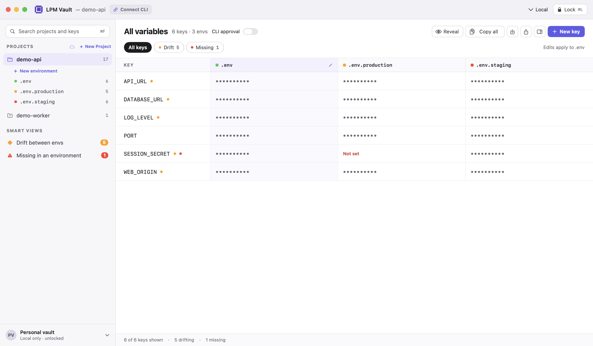

<p align="center">
  <a href="https://vault.lpm.dev"></a>
</p>

<h1 align="center">LPM Vault</h1>

<p align="center">Project environment variables and secrets for your Mac.</p>

<p align="center">
  <a href="https://vault.lpm.dev/download">Download for Mac</a> ·
  <a href="https://cli.lpm.dev/docs/dev/lpm-vault">Documentation</a> ·
  <a href="https://github.com/lpm-dev/lpm-vault/releases">Releases</a> ·
  <a href="SECURITY.md">Security</a>
</p>

LPM Vault is a native macOS app for the environment variables and secrets of your projects.
An env project holds the environments of one project, such as development and production, and the variables of each environment.
LPM Vault stores the values in the macOS Keychain and shares them with the signed LPM CLI.
Encrypted sync through [LPM.dev](https://lpm.dev) is optional. It connects personal and organization env projects.



The screenshot uses dummy project data. It contains no real credentials.

## Install

LPM Vault runs on macOS 14 or later, on Apple silicon and Intel Macs.
You unlock it with Touch ID or with your Mac login password.

1. [Download the installer](https://vault.lpm.dev/download).
2. Open the DMG.
3. Drag **LPM Vault** into **Applications**.
4. Open **LPM Vault**.

Official releases have a Developer ID signature and Apple notarization.
If LPM Vault cannot read its protected data, the locked screen gives the recovery step.
If a project does not load, LPM Vault shows **Retry** and a support link.
Data that LPM Vault cannot read stays protected.

## Updates

To look for a new version, choose **Check for Updates…** in the LPM Vault menu.
LPM Vault asks before it starts to look for updates in the background.

**Settings → Updates** shows the installed version and the update channel.
The **Stable** channel offers stable releases.
The **Nightly** channel offers development releases and newer stable releases. Development releases can contain bugs.
A stable install starts on Stable. A nightly that you install from its DMG starts on Nightly.
LPM Vault keeps your channel choice across app updates and account changes.
Both channels use signed, notarized installers and signed update feeds.

A change of channel does not install an update, and it does not change your stored secrets.
If an update is downloaded or ready to install, install it or skip it before you change the channel.
To open that update again, choose **Check for Updates…**.
If you change from Nightly to Stable, LPM Vault keeps the installed nightly until a newer stable release is available.
LPM Vault never installs an older version by itself. Settings shows when this is the case.

The release workflow runs every night at 03:37 UTC.
It publishes a nightly only when `main` has commits that the last nightly does not have.
Release maintainers can also start the workflow from `main` by hand.
[Release channels](docs/release-channels.md) gives the publishing and recovery procedures.

## What you can do

With LPM Vault, you can:

- Keep the variables of a project in many environments.
- Compare values across environments, and find missing keys, in **All variables**.
- Edit an environment as `.env` text in **Raw text**.
- Import variables from an `.env` file or from pasted text.
- Export an environment to an `.env` file.
- See and edit the rules that `lpm.json` declares for each key, on the **Schema** page.
- Publish an environment to Vercel, Netlify, Coolify, GitHub Actions, or Cloudflare Workers.
- Back up every env project to one file that a passphrase protects, and restore it.
- Find where a value is stored, and find values that you store more than once.
- Use the values with `lpm env`, `lpm dev`, and `lpm run`.
- Sync encrypted data to personal or organization env projects.
- Choose a System, Light, or Dark appearance.

You do not need an LPM.dev account to keep env projects on this Mac.
Cloud sync needs an account and permission for the project.
To connect your account, open **Settings…** from the account menu at the bottom of the sidebar, or press ⌘,.
Then choose **Sign in with browser**.
After the browser step, the browser opens a page that LPM Vault serves on your Mac.
If the sign-in fails, this page tells you how to try again. It loads no external resources.
Go back to LPM Vault to see the connection status.

## Start with a project

1. Unlock LPM Vault.
2. Create an env project.
3. Add environments to the project.
4. Add variables to each environment, or import them.
5. To compare the environments, select **All variables**.
6. To connect the LPM CLI, select **Connect CLI**.

Click a key cell to open the inspector. The inspector shows the values, the rules, and the description of the key.
To change the width of a column, drag its boundary in the table header.
Each project keeps its column widths when you go to Settings and back. LPM Vault does not save them when you quit.

The status bar of a project page counts three kinds of keys.
It counts keys that differ between environments, keys that an environment does not have, and keys that fail their rules.
Click a count to see only those keys in **All variables**.

## Edit, import, and export

**Raw text** shows an environment as `.env` text. You can select and copy single lines, or edit the text.
LPM Vault marks each line that it cannot save, and gives the reason.
Before the save, a review lists each new, changed, and removed key. After the save, you can undo it.

To import variables, drop an `.env` file on the window, choose a file, or paste text.
The review sorts the keys into new, changed, and unchanged keys, and hides their values.
You can keep an existing value or replace it, and you can leave new keys out.
For 30 seconds after an import, you can undo it.

Export makes git ignore the file before it writes the file, as `lpm env export` does.
Export does not write to a file that git tracks.

## Rules for keys

The `lpm.json` file of a project can declare rules for each key. Examples are required keys, formats, defaults, and keys for the browser.
The LPM CLI enforces these rules.
Select **Schema** under a project to see and edit them.
A rule from an imported schema file or a preset shows where it comes from.
Rules from an imported schema are read-only. **Override rules** edits a copy in `lpm.json`, and **Reset to original** removes the copy.

Select a key or a group to edit it in the side panel.
Your edits stay in a draft until you save them. ⌘Z undoes an edit, and ⇧⌘Z does it again.
**Review & save** (⌘S) shows each change as lines of `lpm.json`, and what the change does to the values of each environment.
The review names problems, never values.
LPM Vault writes nothing until you choose **Save to lpm.json**.
A new name for a declared key is different. After you save or discard your draft, LPM Vault writes the new name to `lpm.json` and to the stored values at once.
If `lpm.json` changes on disk, LPM Vault applies your draft again on top of the change.
If the change conflicts with your draft, you choose which one to keep.

LPM Vault tests each stored value against the rules, with the same engine as the LPM CLI.
A value that fails a rule gets a red marker, and its tooltip gives the reason.
When you add a value, LPM Vault tests it while you type.
You can still add a value that fails a rule with **Add anyway**, as `lpm env set` does.
The test covers stored values only. When the LPM CLI runs a command, it can also read the `.env` files of the project and shell variables.

A key that the rules make public shows a globe, and its value is not masked. Frameworks give such keys to the browser.
All other values stay masked until you reveal them.

## Hidden characters

Some characters are hard to see. Examples are a zero-width space, a no-break space, and a newline at the end of a value.
LPM Vault warns about them with the same engine that `lpm env set`, `lpm env import`, and `lpm env check` use.
A warning gives the name and the position of each character, never the value.
**Remove hidden characters** and **Trim the ends** change a value only when you choose them.
A warning never stops a save or an import.

## Find values

**Find Value…** (⇧⌘F) lists each project, environment, and key that stores a value that you paste.
**Find Reused Values…** lists credentials that more than one key, environment, or project stores.
You can search the selected account, or every account on this Mac.
The results name places, never values.
LPM Vault searches only while it is unlocked, and keeps no history or index of a search.

## Publish to platforms

You can publish an environment to these destinations:

- A Vercel project.
- A Netlify site.
- A Coolify application or service.
- GitHub Actions secrets and variables.
- Cloudflare Worker secrets.

1. Open **Platforms** from the account menu at the bottom of the sidebar.
2. Connect your account for the platform.
3. Select an environment.
4. Choose **Publish…** in the title bar.
5. Read the review. It shows what will change before LPM Vault sends anything.

LPM Vault saves each destination for the next publish.

## Back up and restore

**Settings → Backup & Restore** exports every env project to one backup file. A passphrase that you choose protects the file.
To restore a backup, open the same section and choose the file. A review comes before the restore.
Your logins to lpm.dev and to the platforms are not in the backup. On a new Mac, you sign in again.

## Connect the LPM CLI

**Connect CLI** links a project folder through `lpm.json`.
Linking a folder does not install the LPM CLI.
Install the [official LPM CLI](https://cli.lpm.dev/docs/installation) for shared Keychain access.
Then run a project script:

```sh
lpm run dev
```

**Connect CLI** shows commands for the selected environment, with an explicit `--env` flag.
Run these commands from the linked project folder.
The flag overrides the environment that the script settings select. Aliases in `lpm.json` still apply.
If an alias selects another environment, the sheet tells you what to change in the configuration before it shows commands.
If an environment is empty, a script uses the default vault values.

The [app guide](https://cli.lpm.dev/docs/dev/lpm-vault) and the [env guide](https://cli.lpm.dev/docs/dev/env) tell how the LPM CLI selects an environment.

## CLI approval

CLI approval controls whether the LPM CLI must ask you before it reads the values of a project.
To change it, select a project, then use **CLI approval** beside **All variables**.
When CLI approval is off, `lpm run` gets the values without a prompt.
When CLI approval is on, macOS asks for Touch ID or your Mac login password before the Keychain releases the values.
If the authentication fails or you cancel it, the LPM CLI stops before it runs lifecycle hooks or the main script.

In the sidebar, a folder marks automatic CLI access, and a lock marks required CLI approval.
You can change the setting while LPM Vault is unlocked, with no other authentication prompt.
The setting applies to every environment of the project on this Mac.

The **Lock** button hides secrets and clears the authentication of LPM Vault. It does not change CLI approval.
CLI approval protects secret reads and the temporary records that updates use.
It does not take back values that a process already received.

## Changes from the CLI

LPM Vault and the LPM CLI share the LPM home. The LPM home is the folder for your login and env projects, `~/.lpm` by default.
If your shell sets `LPM_HOME`, choose the same folder in **Settings → LPM Home**. LPM Vault then restarts with that folder.
If that folder has no login and no env projects, LPM Vault offers to move them there from the current home first.

When you go back to LPM Vault while it is unlocked, it refreshes the changes that the LPM CLI made.
To refresh while LPM Vault stays active, use **Refresh**.
A refresh reads the project metadata, CLI approval, and secrets of the selected project. It does not contact the cloud.

Unsaved values stay in the editor.
If the LPM CLI changed or deleted a secret, LPM Vault shows a conflict and blocks **Save**.
Copy and export wait for a refresh in progress, so they use the new values.
If a refresh fails, copy, reveal, and export stop until **Retry** succeeds.
An automatic refresh does not reset the idle lock timer. While LPM Vault is locked, it does not read secret values.

## Security and privacy

LPM Vault keeps local secrets in the Data Protection Keychain on this Mac. They do not sync through iCloud Keychain.
Cloud sync encrypts values on your Mac before the upload. It keeps named empty environments, and projects with no keys.
Exported `.env` files and copied values are outside this protection. You must protect them yourself.

The Mac app sends no analytics.
The website uses limited analytics and has an opt-out control.
[PRIVACY.md](PRIVACY.md) describes the network activity of LPM Vault and the privacy of the website.

The [security model](https://cli.lpm.dev/docs/infra/secrets-vault) gives the details of storage and sync.
To report a suspected vulnerability privately, follow [SECURITY.md](SECURITY.md).

## Support and contributions

[SUPPORT.md](SUPPORT.md) tells you how to troubleshoot and how to report an issue.
[CONTRIBUTING.md](CONTRIBUTING.md) gives the development setup and the CI checks.
[RELEASING.md](LPMVault/RELEASING.md) gives signed builds and the release procedure.

A build from source needs its own signing identity and storage contract for Keychain access.
For production secrets and the LPM CLI, use the official installer.

LPM Vault is part of [LPM CLI](https://cli.lpm.dev), [LPM.dev Registry](https://lpm.dev), and [LPM Firewall](https://firewall.lpm.dev).

## License

LPM Vault is dual-licensed under `MIT OR Apache-2.0`, at your option.
See [LICENSE-MIT](LICENSE-MIT) and [LICENSE-APACHE](LICENSE-APACHE).
Third-party components keep their own licenses.
